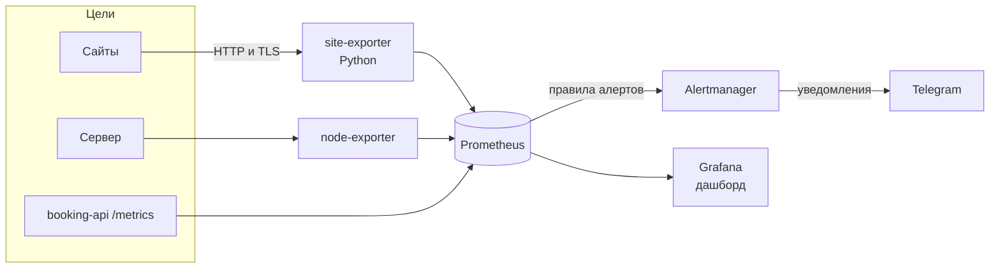

# infra-monitoring — мониторинг сервисов на Prometheus и Grafana

[](https://github.com/tob1s3/infra-monitoring/actions/workflows/ci.yml)

Готовый стек мониторинга, который одной командой поднимается локально или разворачивается
на чистый сервер через Ansible. Он следит за доступностью сайтов, сроками TLS-сертификатов,
состоянием сервера и метриками приложения [booking-api](https://github.com/tob1s3/booking-api).
Алерты приходят в Telegram.

**Стек:** Prometheus, Alertmanager, Grafana, node_exporter, свой экспортер на Python
(asyncio, httpx, prometheus-client), Docker Compose, Ansible, GitHub Actions.



## Что внутри

| Компонент | Зачем |
|---|---|
| **site-exporter** (`exporter/`) | свой экспортер на Python: проверяет сайты по HTTP и читает сроки TLS-сертификатов |
| **Prometheus** | собирает метрики и вычисляет правила алертов (`prometheus/rules/alerts.yml`) |
| **Alertmanager** | группирует алерты, подавляет дубли и отправляет их в Telegram |
| **Grafana** | дашборд «Сайты · Сервер · booking-api», подключается автоматически |
| **node-exporter** | CPU, память, диски и сеть сервера |
| **Ansible** (`ansible/`) | ставит Docker на чистый Ubuntu/Debian и разворачивает весь стек |

### Метрики site-exporter

| Метрика | Значение |
|---|---|
| `site_up` | 1 — сайт ответил ожидаемым кодом, 0 — нет |
| `site_http_status_code` | код ответа (0 — ответа не было: таймаут, DNS, отказ соединения) |
| `site_response_seconds` | время ответа |
| `site_tls_cert_expiry_days` | сколько дней осталось до окончания сертификата |
| `site_checks_total{result}` | счётчик проверок, успешных и нет |

### Алерты

| Алерт | Условие | Важность |
|---|---|---|
| SiteDown | сайт не отвечает дольше 1 минуты | critical |
| SiteSlow | ответ дольше 2 секунд в течение 5 минут | warning |
| TLSCertExpiringSoon / Critical | до окончания сертификата < 14 / < 3 дней | warning / critical |
| ScrapeTargetDown | Prometheus не может собрать метрики | critical |
| HostHighCpu, HostLowMemory, HostDiskAlmostFull | CPU > 85%, свободной памяти < 10%, свободного места на диске < 10% | warning |
| BookingApiHighErrorRate | больше 5% ответов 5xx | critical |
| BookingApiSlow | 95-й перцентиль времени ответа > 1 с | warning |

## Запуск локально

```bash
git clone https://github.com/tob1s3/infra-monitoring.git
cd infra-monitoring
cp .env.example .env              # пароль Grafana, токен и chat_id Telegram-бота
pip install jinja2 && python scripts/render_config.py   # конфиг Alertmanager и файл с токеном
docker compose up -d --build
```

- Grafana: http://localhost:3000 (логин `admin`, пароль из `.env`)
- Prometheus: http://localhost:9090, раздел **Alerts** показывает состояние правил
- Alertmanager: http://localhost:9093

Список сайтов задаётся в `targets.yml`. Если рядом запущен booking-api на порту 8000,
его метрики появятся на дашборде автоматически.

## Развёртывание на сервер через Ansible

```bash
cd ansible
cp inventory.example.ini inventory.ini                      # адрес сервера
cp group_vars/monitoring/vault.example.yml group_vars/monitoring/vault.yml
ansible-vault encrypt group_vars/monitoring/vault.yml       # секреты только в зашифрованном виде
ansible-playbook playbook.yml --ask-vault-pass
```

Плейбук идемпотентный: повторный запуск ничего не ломает и перезапускает контейнеры,
только если изменилась конфигурация. Роли:
- `docker` ставит Docker Engine и compose из официального репозитория;
- `monitoring` копирует конфиги, генерирует `targets.yml` и конфиг Alertmanager из
  переменных, запускает стек и ждёт готовности Prometheus и Grafana.

К веб-интерфейсам на сервере можно подключиться через SSH-туннель:
`ssh -L 3000:127.0.0.1:3000 deploy@сервер`.

## Ключевые решения

**Свой экспортер вместо готового blackbox_exporter.** В продакшене для таких проверок
обычно берут blackbox_exporter. Здесь экспортер написан с нуля, чтобы показать, как они
устроены: асинхронные проверки всех целей параллельно, метрики с лейблами, корректная
остановка по SIGTERM, конфигурация с валидацией через Pydantic. Сертификат проверяется
по-настоящему, с цепочкой доверия и именем хоста.

**Алерты покрыты юнит-тестами.** `prometheus/tests/alerts_test.yml` задаёт историю метрик
и проверяет, когда алерт должен сработать, а когда нет. Например, короткий сбой на одну
проверку не должен будить дежурного. CI запускает эти тесты через `promtool test rules`.

**Меньше шума.** У алертов есть `for:`, поэтому разовые сбои игнорируются. Alertmanager
группирует уведомления и подавляет лишние: если сайт лежит целиком, отдельное
«медленно отвечает» не приходит.

**Секреты не попадают в git.** Токен бота лежит в отдельном файле (`bot_token_file`) с
правами `0400`. На сервере секреты хранятся в `ansible-vault`, `.env` и `secrets/` есть
в `.gitignore`. Задачи Ansible с секретами помечены `no_log`, чтобы токен не попал в логи.

**Интерфейсы закрыты снаружи.** Порты Grafana, Prometheus и Alertmanager слушают только
`127.0.0.1`. Наружу их нужно открывать через reverse proxy с HTTPS, а не напрямую.

**Дашборд как код.** JSON дашборда генерируется скриптом `scripts/build_dashboard.py`,
где видна каждая панель и её запрос PromQL. CI проверяет, что JSON в репозитории
совпадает со сгенерированным.

**Один шаблон Alertmanager на два случая.** `alertmanager.yml.j2` рендерит и Ansible на
сервере, и `scripts/render_config.py` локально, поэтому конфиги не расходятся.

## CI

GitHub Actions на каждый push:
- экспортер: **ruff**, **Bandit**, **pytest** (12 тестов, включая проверку реального TLS-сертификата на локальном сервере);
- **promtool check config** и **promtool test rules**;
- **amtool check-config** для Alertmanager;
- проверка, что дашборд Grafana актуален;
- **ansible-lint** (профиль production) и синтаксис плейбука;
- сборка образа экспортера и сканирование **Trivy**.

## Что можно развить

- Loki и Promtail для сбора логов рядом с метриками.
- Reverse proxy (Caddy или nginx) с HTTPS перед Grafana.
- Molecule-тесты для Ansible-ролей.
